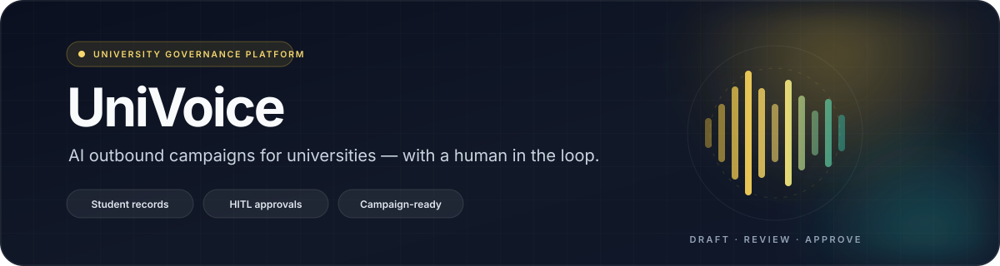
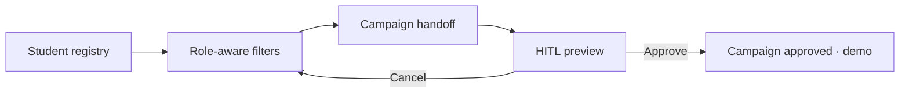

<p align="center">
  
</p>

<p align="center">
  
  
  
  
  
  
</p>

<p align="center">
  <strong>Turn student registries into review-ready voice campaigns — without losing the human in the loop.</strong>
</p>

<p align="center">
  <code>Finance</code> · <code>Admissions</code> · <code>Scholarship</code> · <code>Library</code> · <code>Class Teacher</code>
</p>

> [!NOTE]
> **Demo status** — This repository contains the Next.js frontend. Telephony, live campaign execution, and Python/LangGraph services are not included yet; campaign approvals and analytics are demo/mocked.

## ✨ What is UniVoice?

UniVoice is a department-aware AI workspace for university outreach. Choose a role, filter the student registry, and ask the assistant to draft a targeted voice campaign. Every campaign lands in a human-in-the-loop preview with its audience, criteria, and script summary before approval.

## 🚀 Capabilities

| Capability | What it gives you |
| --- | --- |
| 🎛️ **Department-aware workspace** | Five roles with tailored filters, tables, and campaign context. |
| 📋 **Student registries** | Role-specific TanStack tables with search, filters, pagination, and Supabase/demo data. |
| 📣 **Campaign handoff** | Turn filtered records into a natural-language campaign draft with audience criteria. |
| ✅ **Human-in-the-loop review** | Inspect targets, script summary, and approve or cancel before anything moves forward. |
| 🧠 **Multi-model chat** | Streaming AI chat with a model picker, tool calls, and a side-panel artifact editor. |
| 📊 **Campaign analytics** | Mock dashboards for outcomes, success rates, and department performance. |
| 🔌 **Connected registries** | Staff-only Supabase connection setup with RLS safeguards. |

## 🧭 How it works



## 🛠️ Tech stack

| Layer | Powered by |
| --- | --- |
| App | Next.js 16 App Router, React 19, TypeScript |
| AI | AI SDK 7, Vercel AI Gateway, streaming + tool calls |
| UI | Tailwind CSS v4, shadcn/ui, Radix UI, Lucide, Framer Motion |
| Data | Drizzle ORM, PostgreSQL, Supabase (RLS-gated reads) |
| Platform | Auth.js, Redis, Vercel Blob |
| Quality | Biome / Ultracite, Playwright |

## ⚡ Quick start

**Prerequisites:** Node.js 20+ and pnpm 10+.

```bash
cd frontend
pnpm install
cp .env.example .env.local   # Windows: copy .env.example .env.local
```

Fill in the required values in `frontend/.env.local`:

```dotenv
AUTH_SECRET=...            # 32+ chars; openssl rand -base64 32
POSTGRES_URL=postgres://...
AI_GATEWAY_API_KEY=...     # required outside Vercel
```

| Optional | Enables |
| --- | --- |
| `REDIS_URL` | IP rate limiting and resumable streams |
| `BLOB_READ_WRITE_TOKEN` | File uploads |
| `NEXT_PUBLIC_SUPABASE_URL` + `NEXT_PUBLIC_SUPABASE_ANON_KEY` | Live registry reads |
| `NEXT_PUBLIC_SUPABASE_RLS_RESOLVED=true` | Protected live tables after RLS is verified |

Then start the app:

```bash
pnpm db:migrate
pnpm dev
```

Open **http://localhost:3000**. `/ping` is the health check.

## 🧰 Commands

Run these from `frontend/`:

| Command | What it does |
| --- | --- |
| `pnpm dev` | Start the Turbopack dev server |
| `pnpm build` | Apply DB migrations, then build for production |
| `pnpm check` / `pnpm fix` | Lint and format with Ultracite |
| `pnpm exec tsc --noEmit` | Typecheck the frontend |
| `pnpm test` | Run the Playwright e2e suite |
| `pnpm db:generate` | Generate a migration after schema changes |
| `pnpm db:migrate` | Apply pending migrations |

> `pnpm test` uses mocked AI models and starts the dev server automatically; a reachable Postgres is required for guest auth.

## 📁 Project structure

```text
frontend/
├── app/          # Pages, API routes, auth
├── components/   # Chat, student records, analytics, shared UI
├── lib/          # AI, database, Supabase, campaign logic
├── modules/      # Student and department domain data
├── artifacts/    # Code, text, sheet, and image artifacts
├── tests/        # Playwright e2e suite
└── docs/         # Project state and code index
```

## 🗺️ Roadmap

- [x] Role-aware student registries
- [x] HITL campaign preview and handoff
- [x] Mock campaign analytics
- [ ] Campaign persistence in Drizzle
- [ ] Live Supabase reads from chat tools
- [ ] Role-aware zero-prompting system instructions

## 📚 Documentation

- [Project state & invariants](frontend/docs/PROJECT_STATE.md)
- [Code index](frontend/docs/CODE_INDEX.md)

## 📄 License

The frontend is based on the Vercel Chatbot template. See [frontend/LICENSE](frontend/LICENSE) for the Apache-2.0 license.

<p align="center"><sub>Built for university teams who still want a human in the loop.</sub></p>
